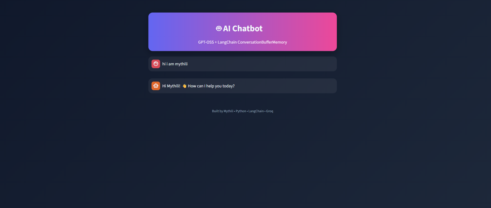

# AI Chatbot with Memory


A conversational AI chatbot that **remembers what you say** during a chat. Built with Python, LangChain and Llama 3.3 (served by Groq), with a custom HTML/CSS-styled Streamlit interface.



---

##  Overview

Large Language Models are **stateless**: they forget everything between requests. This project solves that by adding **conversation memory** with LangChain's `ConversationBufferMemory`, so the chatbot can hold a natural, multi-turn conversation.

The project started as a **local LLM chatbot using Ollama (llama3.2)** and was then upgraded to a hosted API (Groq) so it could be deployed publicly.

## Problem Statement

A plain LLM call has no context of earlier messages. If you say *"My name is Mythili"* and then ask *"What is my name?"*, it cannot answer. This app stores the chat history and sends it back to the model on every turn, so the bot stays context-aware.

##  Features

- **Conversation memory** using LangChain `ConversationBufferMemory`
- **Streaming responses**, with the reply appearing word by word
- **Custom UI** with HTML and CSS (gradient header, styled chat bubbles, dark theme)
- **Clear chat** button that resets the memory
- **Separate memory per visitor** using Streamlit session state
- **Secure API key handling** with Streamlit secrets
- **Free deployment** on Streamlit Community Cloud

##  Tech Stack

| Category | Tool |
|---|---|
| Language | Python |
| LLM | Llama 3.3 70B (via Groq API) |
| Framework | LangChain |
| Memory | `ConversationBufferMemory` |
| UI | Streamlit + HTML + CSS |
| Local LLM (early version) | Ollama (llama3.2) |
| Deployment | Streamlit Community Cloud |
| Version Control | Git, GitHub |

## How It Works

```
User message
     │
     ▼
Load history from memory
     │
     ▼
Prompt = System rule + History + New message
     │
     ▼
Groq API (Llama 3.3)
     │
     ▼
Stream reply to the UI
     │
     ▼
Save user message + reply to memory
```

1. The user types a message in the chat box.
2. The app loads all past messages from `ConversationBufferMemory`.
3. A `ChatPromptTemplate` builds the full prompt: system instruction, history and the new input.
4. The prompt goes to Llama 3.3 on Groq, and the reply streams back.
5. The new user message and bot reply are saved to memory for the next turn.

##  Memory Types

| Type | Behavior | Used here |
|---|---|---|
| Buffer | Stores every message |  
| Window buffer | Keeps only the last N messages | Earlier version |
| Summary | LLM summarizes old messages | Planned |

##  Project Structure

```
local-llm-chatbot/
├── app.py                  # Main Streamlit app (UI + LangChain + memory)
├── requirements.txt        # Python dependencies
├── README.md               # Project documentation
├── .gitignore              # Files excluded from Git
├── screenshot.png          # App screenshot
└── .streamlit/
    └── secrets.toml        # API key (local only, NOT pushed to GitHub)
```

## Getting Started

### Prerequisites
- Python 3.10 or higher
- A free Groq API key from [console.groq.com/keys](https://console.groq.com/keys)

### Installation

```bash
# 1. Clone the repository
git clone https://github.com/Mythilikalidhasan/local-llm-chatbot.git
cd local-llm-chatbot

# 2. Create and activate a virtual environment
python -m venv venv
venv\Scripts\activate          # Windows
# source venv/bin/activate     # Mac/Linux

# 3. Install dependencies
pip install -r requirements.txt
```

### Add your API key

Create `.streamlit/secrets.toml`:

```toml
GROQ_API_KEY = "your_groq_api_key_here"
```

### Run the app

```bash
streamlit run app.py
```

Open `http://localhost:8501` in your browser.

## Test the Memory

```
You: My name is Mythili and I love Java
You: What is my name?
Bot: Your name is Mythili.
You: What language do I love?
Bot: You love Java.
```

##  Deployment

1. Push the project to GitHub (without `secrets.toml`).
2. Go to [share.streamlit.io](https://share.streamlit.io) and sign in with GitHub.
3. Click **New app** and select this repo and `app.py`.
4. Open **Advanced settings → Secrets** and add:
   ```toml
   GROQ_API_KEY = "your_groq_api_key_here"
   ```
5. Click **Deploy**.

## Future Improvements

- [ ] Switch to **summary memory** (`ConversationSummaryBufferMemory`) for long chats
- [ ] **Persistent memory** using SQLite or a database, so chats survive restarts
- [ ] **User login** and multiple saved chat sessions
- [ ] **RAG support** to chat with uploaded PDFs and documents (Chroma + embeddings)
- [ ] **Model selector** in the sidebar (Llama, Gemma, Mixtral)
- [ ] **Adjustable settings** for temperature and system prompt
- [ ] **Voice input and output** (speech to text, text to speech)
- [ ] **Export chat** as PDF or TXT
- [ ] **Docker** support for easy deployment
- [ ] Unit tests and CI with GitHub Actions

##  What I Learned

- How LLMs are stateless and why memory is needed
- Building prompts with `ChatPromptTemplate` and `MessagesPlaceholder`
- Different LangChain memory types and their trade-offs
- Streaming LLM output in a web UI
- Managing API keys safely with secrets
- Deploying a Python app to the cloud for free

##  Contributing

Suggestions and pull requests are welcome. Open an issue to discuss what you'd like to change.

## Author

**Mythili K**
B.Sc. Computer Science with AI, SDNB Vaishnav College for Women, Chennai

- GitHub: [Mythilikalidhasan](https://github.com/Mythilikalidhasan)
- LinkedIn: [Mythili K](https://www.linkedin.com/in/mythili-k-392843378)
- Email: mythilikalidhasan013@gmail.com

---

If you found this project useful, please give it a star!